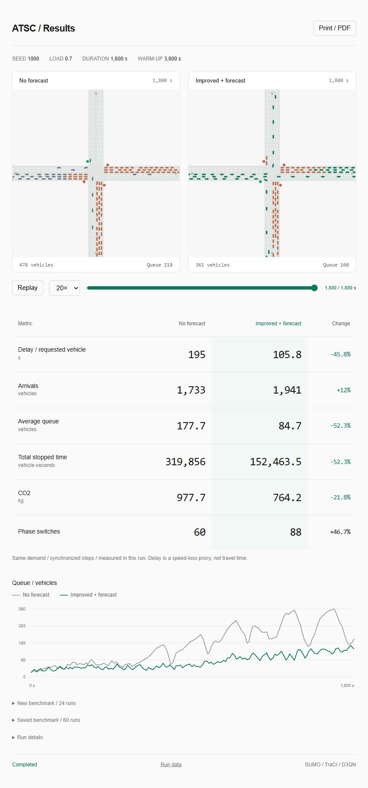

# Adaptive Traffic Signal Control

**Two live intersections on one website. Two trained agents. Identical traffic.**

Compare the original controller **without forecasting** against an **improved
trained policy with a TGCN forecast**, then view measured differences.
Runs natively on Windows; no WSL, training, or web service required.



## Results notebook

Open [the executed notebook](notebook/Results_Evidence.ipynb) to follow the
analysis from individual experiment records to the reported results. It includes
258 test runs, paired controller comparisons, forecasting baselines, and eight
figures. All outputs are saved for viewing on GitHub.

For a presentation without Jupyter, download the repository and open
`notebook/Results_Evidence.html` in a browser. To rerun the analysis, follow the
[notebook instructions](notebook/README.md). Its inputs are included, including
the PeMS08 data needed to recompute two forecasting baselines. This notebook
analyses saved experiments; it does not rerun model training or SUMO.

## Quick start

Install [Python 3.12](https://www.python.org/downloads/) and
[SUMO 1.27.1](https://sumo.dlr.de/docs/Downloads.php). Clone this repository,
then run in PowerShell:

```powershell
.\setup.cmd
$env:SUMO_HOME = "D:\SUMO"  # your SUMO installation
.\demo.cmd
```

`setup.cmd` installs the inference dependencies and downloads PeMS08 from the
experiment's recorded source, verifying its SHA-256. Internet is only needed
for setup. Trained checkpoints are already included.

### What opens

A local website with two live intersections, followed by numerical results.
Use `--sumo-gui` to additionally open the native SUMO windows.

| Left website panel | Right website panel |
| --- | --- |
| No forecast | Improved + forecast |
| Original D3QN, 40 inputs | Distilled DuelingQ + TGCN + guard, 56 inputs |
| `d3qn_no_forecast_seed0.pt` | Validation-selected `candidate_5.pt` or `candidate_30.pt` |

Both simulations use the same demand seed, route file contents, warm-up, and
measurement horizon. Separate Python processes synchronize every **0.5 seconds
of simulation time**, including warm-up. The policy decides every 10 green
seconds; switching adds 3 yellow seconds.

The initial 3,600 simulated seconds collect forecast history using the original
cyclic warm-up controller. Wait for **AI ACTIVE**. The default demonstration
then measures 1,800 simulated seconds without added playback delay. The browser opens immediately with two
live canvas views driven by real SUMO vehicle positions and traffic lights.
SUMO runs in the background. When the run finishes, the same page switches to
a portable replay and results:

- Delay per requested vehicle
- Arrivals and average queue
- Total stopped time and CO2
- Phase switches and percentage differences
- Queue traces for both agents

**This is a comparison, not a promise that the forecasting policy wins.**
Results are calculated from the two runs that just finished. Saved historical
benchmarks are available in a collapsed section and are never mixed into the
live comparison.

On six fresh hour-long traffic scenarios (two seeds per load), the improved
configuration reduced mean delay versus the original no-forecast policy by
**52% / 39% / 11%** at loads **0.40 / 0.70 / 0.95**. One congested case
regressed by 1.6%. These are separate benchmark results, not numbers injected
into the live demo. The previous guarded policy remains stronger at medium
and high load; use `--policy guarded` to compare it.

## Commands

```powershell
# Also show the native SUMO-GUI windows
.\demo.cmd --sumo-gui

# Shorter presentation; retain full forecast warm-up
.\demo.cmd --duration 120

# Lower traffic demand, slower playback
.\demo.cmd --saturation 0.4 --delay 100

# Queue-aware distilled policy with forecasting and the no-green bound
.\demo.cmd --policy improved

# Previously trained guarded continuation
.\demo.cmd --policy guarded

# Automated smoke check; incomplete forecast history
.\demo.cmd --headless --warmup 0 --duration 30 --no-browser

# Reopen the latest saved results
.\.venv\Scripts\python.exe -m atsc.demo_report

# Single-window guarded policy (120-second no-green bound)
.\.venv\Scripts\python.exe -m atsc.demo --agent guarded
```

Use `--policy original` for the two original trained policies.
The improved controller adds queue-aware policy distillation, red-time clocks
and an action mask. Its gains cannot be attributed to forecasting alone.
It chooses a checkpoint by the requested load using validation results.
See [training protocol and results](docs/improvement.md). A five-minute run
can still regress while queues adjust; the default observes 30 simulated minutes.

## Project layout

```text
atsc/
  compare.py          Two-process synchronized demo
  web_demo.py         Local live-dashboard server
  demo.py             Single trained-policy runner
  demo_report.py      Offline results builder
  demo_report.html    Minimal English results UI
  environment.py      Shared SUMO environment (libsumo / TraCI)
  network.py          Network and demand generation
  models.py           Forecasting and dueling Q networks
  guarded.py          Feasible-action mask and red-time clocks
  control.py          Original training and evaluation
  continuation.py     Guarded continuation experiment
  improve.py          Separate policy-distillation experiment and benchmark
  traci_cache.py      Batched vehicle observations for faster native demos
artifacts/            Trained weights and original experiment results
data/network/         Original intersection and detectors
tests/                Simulation, guard, pairing and report checks
demo.cmd              Launch the live website and both simulations
setup.cmd             Install demo dependencies and prepare demand data
```

Generated files stay in ignored `demo_runs/`. Each paired run includes separate
controller logs, tripinfo, route hashes, checkpoint hashes, a combined
`summary.json`, recorded frames, and a portable `results.html` with replay.
Keep the terminal open while using the live page; Ctrl+C stops its local server.
The saved HTML replay works independently afterwards.
Replay defaults to 20x, with 5x and 60x also available for presentations.

## Reproducibility

The experiment includes PeMS04/08 forecasters, original D3QN checkpoints, and a
guarded continuation selected on validation scenarios. Numerical results and
weights are retained unchanged. `MANIFEST_SHA256.json` records the **original
research snapshot**, not the updated demo source tree.

The English [results notebook](notebook/Results_Evidence.ipynb) consolidates
the original experiments, guarded continuation and final distillation results.
Its [HTML export](notebook/Results_Evidence.html) can be downloaded and opened
locally. Earlier standalone HTML reports and replay exports have been removed;
their raw experiment data and trained weights remain in `artifacts/`.
The snapshot manifest may therefore reference historical exports that are no
longer included in the current checkout. Legacy report-generation scripts remain
available for reproducing those exports explicitly.

Delay is an integrated speed-loss proxy plus pending-insertion time, divided by
requested demand; it is not mean completed-trip travel time. TTC is a rear-end
conflict surrogate, not a collision count. The 120-second guard bounds time
without green for an approach, not each vehicle's waiting time.

Scope: one synthetic intersection, one training seed per policy, limited
training. Demand seeds do not substitute for independent training seeds.
This project is a research demonstration, not a road deployment system.

## Development

```powershell
.\.venv\Scripts\python.exe -m pip install -r requirements.txt
.\.venv\Scripts\python.exe -m atsc.prepare_demo
.\.venv\Scripts\python.exe -m unittest discover -s tests -v
```

Full tests also require `libsumo`; the GUI demo only requires TraCI. See
[Windows notes](DEMO_WINDOWS.md) and [contribution notes](CONTRIBUTING.md).
The training commands in `atsc.control`, `atsc.forecast` and
`atsc.continuation` are independent of the demonstration and may overwrite
their experiment outputs when explicitly run.

## Sources

- [SUMO / TraCI](https://sumo.dlr.de/docs/TraCI/Interfacing_TraCI_from_Python.html)
- [PeMS benchmark files via ASTGNN](https://github.com/guoshnBJTU/ASTGNN/tree/main/data)
- [T-GCN reference](https://github.com/lehaifeng/T-GCN)

Dataset provenance and checksums are recorded in `data/manifest.json`.
Third-party dependencies and datasets retain their respective licenses.
